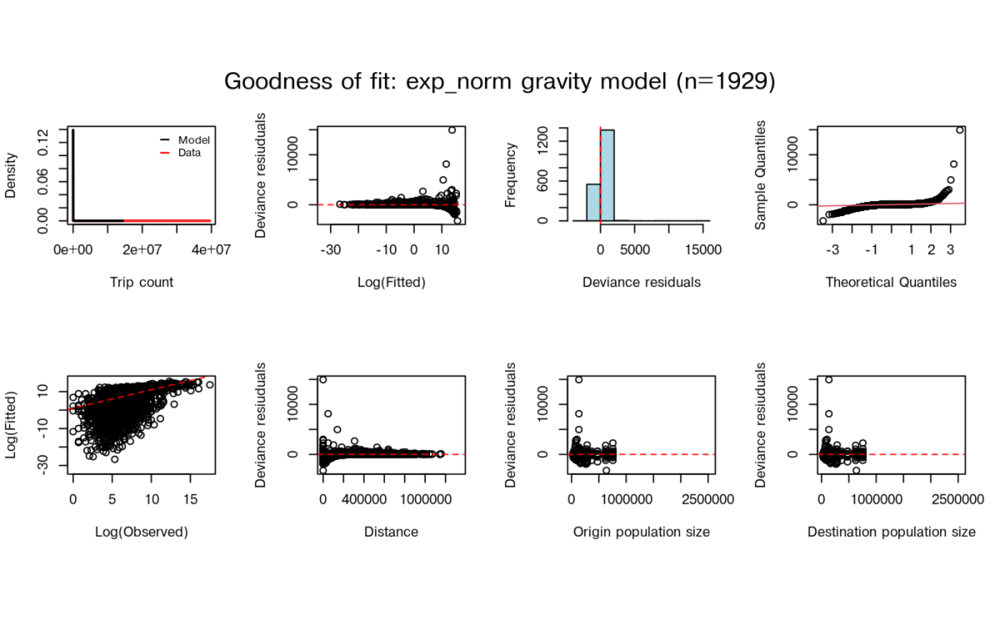

# Introduction

`nomad` stores fitted mobility models for infectious disease modelling.
The usual workflow is:

1.  identify a plausible source mobility dataset;
2.  inspect the fitted models available for that dataset;
3.  prepare a distance matrix and population vector for the prediction
    setting;
4.  predict a mobility matrix;
5.  check warnings and sensitivity to alternative models.

``` r

library(nomad)
```

## Available Data And Models

The mobility catalogue describes the datasets used to fit the models in
the package. Looking through it helps us find data collected in settings
similar to our own, taking account of when movement was measured, whose
journeys were recorded and the size of the regions. These details will
help us decide which models are worth exploring for our analysis.

``` r

mobility_table()
```

    #> # A tibble: 56 × 14
    #>    name    country date_start date_end         n type  sampling_scheme censoring
    #>    <chr>   <chr>   <date>     <date>       <dbl> <chr> <chr>           <chr>    
    #>  1 ken_cd… KEN     2008-06-01 2009-07-03 8.48e10 call… 100% of leadin…  NA      
    #>  2 nam_cd… NAM     2010-10-02 2014-04-30 1.84e 9 call… 100% of leadin… "Two dis…
    #>  3 bfa_cd… BFA     2016-01-01 2016-12-31 3.77e 7 call… 1.4% random se…  NA      
    #>  4 zmb_cd… ZMB     2020-08-01 2020-12-30 1.12e 8 call… 100% of leadin…  NA      
    #>  5 zmb_fb… ZMB     NA         NA         9.53e 6 face… NA               NA      
    #>  6 ago_fb… AGO     2024-07-29 2025-06-16 3.98e 8 face… Facebook Activ… "<10 tri…
    #>  7 bdi_fb… BDI     2024-07-29 2025-06-16 3.03e 7 face… Facebook Activ… "<10 tri…
    #>  8 ben_fb… BEN     2024-07-29 2025-06-16 7.99e 7 face… Facebook Activ… "<10 tri…
    #>  9 bfa_fb… BFA     2024-07-29 2025-06-16 1.15e 8 face… Facebook Activ… "<10 tri…
    #> 10 bwa_fb… BWA     2024-07-29 2025-06-16 2.85e 7 face… Facebook Activ… "<10 tri…
    #> # ℹ 46 more rows
    #> # ℹ 6 more variables: aggregation <chr>, publication <chr>,
    #> #   has_fitted_models <lgl>, prediction_period_days <dbl>, distance_unit <chr>,
    #> #   provenance <chr>

Some datasets are included in the catalogue because they may be useful
for future analyses, although we do not yet have their fitted models.
The `has_fitted_models` column lets us identify which datasets already
have models that we can use. We can then look at the model catalogue to
see the available variants and how well each fit the source data. For
example, the following returns all the models fit to data from Zambia.

``` r

model_table(country = "ZMB")
```

    #> # A tibble: 14 × 27
    #>    name      data_name mobility_model model_type hierarchical max_rhat min_n_eff
    #>    <chr>     <chr>     <chr>          <chr>      <lgl>           <dbl>     <dbl>
    #>  1 zmb_cdr_… zmb_cdr_… departure-dif… exp        FALSE            1.01      1239
    #>  2 zmb_fb_2… zmb_fb_2… gravity        exp        FALSE            1.01         2
    #>  3 zmb_fb_2… zmb_fb_2… departure-dif… exp        FALSE            1.01       655
    #>  4 zmb_fb_2… zmb_fb_2… departure-dif… power      FALSE            1.01       587
    #>  5 zmb_fb_2… zmb_fb_2… departure-dif… radiation  FALSE            1.01      1060
    #>  6 zmb_fb_2… zmb_fb_2… gravity        basic      FALSE            1            0
    #>  7 zmb_fb_2… zmb_fb_2… gravity        exp        FALSE            1.05         3
    #>  8 zmb_fb_2… zmb_fb_2… gravity        exp_norm   FALSE            1.01       801
    #>  9 zmb_fb_2… zmb_fb_2… gravity        power      FALSE            1.55         3
    #> 10 zmb_fb_2… zmb_fb_2… gravity        power_norm FALSE            1          804
    #> 11 zmb_fb_2… zmb_fb_2… gravity        scaled_po… FALSE            1.03        66
    #> 12 zmb_fb_2… zmb_fb_2… gravity        transport  FALSE            1            0
    #> 13 zmb_fb_2… zmb_fb_2… radiation      basic      FALSE           NA           NA
    #> 14 zmb_fb_2… zmb_fb_2… radiation      finite     FALSE           NA           NA
    #> # ℹ 20 more variables: rhat_above_1_1 <lgl>, supports_newdata <lgl>,
    #> #   supports_stochastic_draws <lgl>, DIC <dbl>, RMSE <dbl>, MAPE <dbl>,
    #> #   R2 <dbl>, country <chr>, date_start <date>, date_end <date>, n <dbl>,
    #> #   data_type <chr>, sampling_scheme <chr>, censoring <chr>, aggregation <chr>,
    #> #   publication <chr>, has_fitted_models <lgl>, prediction_period_days <dbl>,
    #> #   distance_unit <chr>, provenance <chr>

## Inspect A Model

Let’s choose the normalised exponential gravity model fit to the newer
Zambia Facebook data. We can use
[`model_profile()`](https://ojwatson.github.io/nomad/reference/model_profile.md)
to see the number of source regions, their populations and distances,
and the period represented by a prediction. This gives us a starting
point for comparing the source setting with our own.

``` r

model <- model_db$zmb_fb_2025_mod_grav_exp_norm
model_profile(model)
```

    #> # A tibble: 1 × 27
    #>   name  data_name country aggregation date_start date_end   source_duration_days
    #>   <chr> <chr>     <chr>   <chr>       <date>     <date>                    <dbl>
    #> 1 zmb_… zmb_fb_2… ZMB     admin_2     2024-07-29 2025-06-16                   21
    #> # ℹ 20 more variables: prediction_period_days <dbl>, distance_unit <chr>,
    #> #   supports_newdata <lgl>, supports_stochastic_draws <lgl>, n_origin <int>,
    #> #   n_dest <int>, distance_min <dbl>, distance_q25 <dbl>,
    #> #   distance_median <dbl>, distance_q75 <dbl>, distance_max <dbl>,
    #> #   population_total <dbl>, population_min <dbl>, population_median <dbl>,
    #> #   population_max <dbl>, max_rhat <dbl>, min_n_eff <dbl>,
    #> #   rhat_above_1_1 <lgl>, has_mobility_data <lgl>, has_saved_check <lgl>

We can then look at how well the model reproduced the observed trips
using [`check()`](https://ojwatson.github.io/nomad/reference/check.md)
and [`plot()`](https://rdrr.io/r/graphics/plot.default.html). These
saved summaries are included even when the underlying trip observations
cannot be shared publicly. The [model selection
vignette](https://ojwatson.github.io/nomad/articles/selecting-a-model.md)
explains how to interpret them.

``` r

check(model, plots = FALSE)
```

    #> $DIC
    #> [1] NA
    #> 
    #> $RMSE
    #> [1] 965441.9
    #> 
    #> $MAPE
    #> [1] 32.18002
    #> 
    #> $R2
    #> [1] 0.1056686

``` r

plot(model)
```



## Prepare A Small Prediction Setting

To predict movement, we need a distance matrix `D` and a population
vector `N` for our regions. These are the same inputs used by
`mobility::predict()`. If the origins and destinations have different
populations, they can instead be supplied as `N_orig` and `N_dest`.

Here we construct a small example with five place names. The populations
and coordinates are invented to show how to arrange the inputs, and
should not be used as estimates for those places. We multiply the
distances between the coordinates by 120 to give our example distances
in kilometres. For your own analysis, you could prepare these inputs
from a shapefile and population data, as shown in the [README
example](https://ojwatson.github.io/nomad/).

Show how to construct the example regions

``` r

places <- data.frame(
  name = c("Lusaka", "Kabwe", "Ndola", "Kitwe", "Livingstone"),
  x = c(0, 1.2, 2.8, 2.6, -1.4),
  y = c(0, 1.0, 2.7, 2.4, -2.7),
  population = c(2500000, 230000, 475000, 690000, 170000)
)

D <- as.matrix(dist(places[, c("x", "y")])) * 120
dimnames(D) <- list(places$name, places$name)
N <- setNames(places$population, places$name)
newdata <- list(D = D, N = N)
```

## Make A Prediction

We can now pass the distances and populations to
[`predict()`](https://rdrr.io/r/stats/predict.html), specifying that our
distances are in kilometres. You will see warnings because these five
regions contain a smaller population and cover fewer locations than the
data used to fit the model. The prediction can still be calculated, but
those warnings help us identify differences between our example and the
setting in which the model was fit.

``` r

M <- predict(model, newdata = newdata, unit = "km")
```

    #> Warning: ! Prediction data have far fewer regions than the fitted source data.
    #> ℹ `newdata` has "5" regions; the fitted model has "115".
    #> • Predictions may be coarser than the source data can support.

    #> Warning: ! Prediction population is much smaller than the fitted source population.
    #> ℹ `newdata` population: "4065000"; fitted model source population: "18296043".
    #> • Check that this model is suitable for the population scale being predicted.

``` r

round(M / 1000, 1)
```

    #>              Lusaka  Kabwe  Ndola  Kitwe Livingstone
    #> Lusaka      34681.3   53.7    0.0    0.0         0.1
    #> Kabwe           4.9 3189.6    0.2    0.9         0.0
    #> Ndola           0.0    0.3 5389.0 1210.3         0.0
    #> Kitwe           0.0    2.1 1757.8 7826.9         0.0
    #> Livingstone     0.0    0.0    0.0    0.0      2362.0
    #> attr(,"model")
    #> [1] "gravity"
    #> attr(,"type")
    #> [1] "exp_norm"
    #> attr(,"source_duration_days")
    #> [1] 21
    #> attr(,"prediction_period_days")
    #> [1] 21
    #> attr(,"duration_scale")
    #> [1] 1
    #> attr(,"data_name")
    #> [1] "zmb_fb_2025"

The result is a matrix in which rows identify the origin of a trip and
columns identify its destination. We have divided the values by 1,000 to
make them easier to read, so a value of 2 represents 2,000 predicted
trips. These are counts of trips, to which a person may contribute more
than once. The period is taken from the model metadata and is 21 days
for this fit. The names on the distance matrix and population vector
must identify the same regions so that `nomad` can match each population
to the correct location.

For a real analysis, we would now consider whether the model describes
movement at a suitable scale for our question. For example, a model fit
to movement between districts may tell us little about journeys between
neighbourhoods within a city. Comparing alternatives is useful when
several models could plausibly describe the movement we want to study.

## Predict for the source regions

The fitted model also includes the distances and populations used for
fitting. These inputs are often called covariates. We can reuse them to
predict movement for the original regions, which provides a useful
comparison with predictions for a new setting.

``` r

source_data <- model$get_model()$data[c("D", "N_orig", "N_dest")]
M_source <- predict(model, newdata = source_data)
M_source[1:5, 1:5]
```

    #>            destination
    #> origin         ZMB.1.1_1    ZMB.1.2_1    ZMB.1.3_1    ZMB.1.4_1    ZMB.1.5_1
    #>   ZMB.1.1_1 4.503207e+06 207404.91311 1.175758e+01 2.866407e+03 3.067882e+05
    #>   ZMB.1.2_1 4.595483e+04 997777.28396 2.401973e+01 4.359945e+01 1.965902e+05
    #>   ZMB.1.3_1 2.233465e+00     20.59288 8.554261e+05 1.436979e-03 3.196422e+01
    #>   ZMB.1.4_1 8.675690e+02     59.55731 2.289578e-03 1.362974e+06 5.927834e+01
    #>   ZMB.1.5_1 1.268509e+05 366863.60721 6.957575e+01 8.098131e+01 1.861987e+06

## Choose a prediction period

If we want a prediction for a different time period, we can supply
`duration` in days or a `date_start`/`date_end` pair. This scales the
prediction in proportion to the period recorded in the model metadata,
assuming that the average daily trip rate stays constant. For example,
the request below uses 30 / 21 as its multiplier because the newer
Facebook models predict trip counts over 21 days. The dates over which
data were collected are stored separately and do not determine this
multiplier.

``` r

M_30 <- predict(model, newdata = source_data, duration = 30)
attr(M_30, "duration_scale")
```

    #> [1] 1.428571

The returned `duration_scale` is the multiplier applied to the original
prediction, in this case approximately 1.43.

Models can also be shared through `nomad` with incomplete source
metadata, as with the earlier Zambia Facebook and CDR models from 2020.
Without a prediction period, we can explore their unscaled predictions
but cannot convert the counts to trips over a specified number of days.
The package warns when returning such a prediction and raises an error
if we request a duration conversion. This makes the available models
accessible while showing where missing information limits their use in
an analysis.

## Compare Alternatives

Several models were fit to the Zambia Facebook observations. We can
compare their fit statistics and use
[`model_weights()`](https://ojwatson.github.io/nomad/reference/model_weights.md)
to calculate weights from one of those measures. Here we use root mean
squared error (RMSE), which gives more weight to models that reproduced
the source observations more closely. This comparison uses models fit to
the same dataset, so their errors refer to the same observed trips.

``` r

weights <- model_weights(data_name = "zmb_fb_2025", metric = "RMSE")
weights[, c("name", "RMSE", "weight")]
```

    #> # A tibble: 12 × 3
    #>    name                                    RMSE   weight
    #>    <chr>                                  <dbl>    <dbl>
    #>  1 zmb_fb_2025_mod_dd_exp               946018. 0.0898  
    #>  2 zmb_fb_2025_mod_dd_power             946521. 0.0897  
    #>  3 zmb_fb_2025_mod_dd_radiation         946973. 0.0897  
    #>  4 zmb_fb_2025_mod_grav_basic        819787890. 0.000104
    #>  5 zmb_fb_2025_mod_grav_exp             947086. 0.0897  
    #>  6 zmb_fb_2025_mod_grav_exp_norm        965442. 0.0879  
    #>  7 zmb_fb_2025_mod_grav_power           942100. 0.0901  
    #>  8 zmb_fb_2025_mod_grav_power_norm      946881. 0.0897  
    #>  9 zmb_fb_2025_mod_grav_scaled_power    952655. 0.0891  
    #> 10 zmb_fb_2025_mod_grav_transport      1057907. 0.0803  
    #> 11 zmb_fb_2025_mod_rad_basic            831656. 0.102   
    #> 12 zmb_fb_2025_mod_rad_finite           833482. 0.102

We can also use
[`nomad_ensemble()`](https://ojwatson.github.io/nomad/reference/nomad_ensemble.md)
to combine predictions from several models. For a simple example, we
will select the exponential departure-diffusion model and combine it
with the gravity model used above. Both were fit to the same Facebook
dataset. Because we ask each model to predict for the same regions and
period, we can take a weighted average of their predicted trip counts.
We choose weights of 0.5 for this example, giving each model equal
influence, rather than deriving the weights from their fit statistics.

``` r

departure_model <- model_db$zmb_fb_2025_mod_dd_exp
ensemble <- nomad_ensemble(
  list(departure = departure_model, gravity = model),
  weights = c(departure = 0.5, gravity = 0.5)
)
M_ensemble <- predict(ensemble, newdata = newdata, unit = "km")
```

    #> Warning: ! Prediction data have far fewer regions than the fitted source data.
    #> ℹ `newdata` has "5" regions; the fitted model has "115".
    #> • Predictions may be coarser than the source data can support.

    #> Warning: ! Prediction population is much smaller than the fitted source population.
    #> ℹ `newdata` population: "4065000"; fitted model source population: "18296043".
    #> • Check that this model is suitable for the population scale being predicted.

    #> Warning: ! Prediction data have far fewer regions than the fitted source data.
    #> ℹ `newdata` has "5" regions; the fitted model has "115".
    #> • Predictions may be coarser than the source data can support.

    #> Warning: ! Prediction population is much smaller than the fitted source population.
    #> ℹ `newdata` population: "4065000"; fitted model source population: "18296043".
    #> • Check that this model is suitable for the population scale being predicted.

``` r

round(sum(M_ensemble))
```

    #> [1] 56989960

## Explore parameter uncertainty

So far we have used the mean fitted parameters to make each prediction.
Setting `nsim` to a value greater than one instead gives repeated
predictions using approximate parameter draws from the stored means and
standard deviations. The summary below reports how much the total number
of trips and the number between different regions vary across those
draws. This captures parameter uncertainty within the selected model,
while comparing alternative models lets us explore uncertainty about the
choice of model itself.

``` r

draws <- predict(model, newdata = source_data, nsim = 10, seed = 1)
uncertainty_summary(draws, metrics = c("total", "between_region"))
```

    #> # A tibble: 6 × 3
    #>   metric          prob      value
    #>   <chr>          <dbl>      <dbl>
    #> 1 total          0.025 254163766.
    #> 2 total          0.5   254206733.
    #> 3 total          0.975 254234581.
    #> 4 between_region 0.025  93395200.
    #> 5 between_region 0.5    93420244.
    #> 6 between_region 0.975  93436944.

To explore these choices further, [Selecting a mobility
model](https://ojwatson.github.io/nomad/articles/selecting-a-model.md)
works through the warnings and uncertainty summaries in more detail, and
shows how to compare predictions from several models. Once you have a
set of plausible models, [Identifying a mobility model for an
outbreak](https://ojwatson.github.io/nomad/articles/outbreak-model-selection.md)
shows how to compare them using the daily incidence of a simulated
outbreak.
